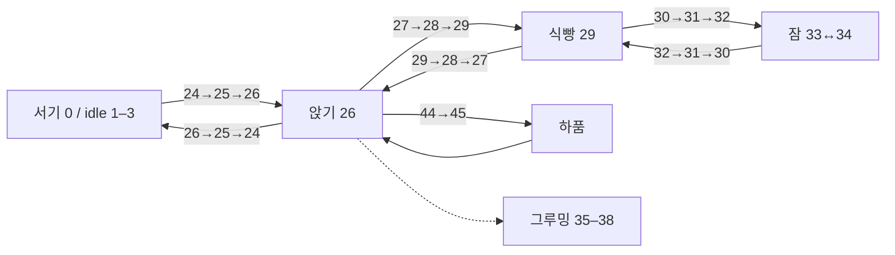
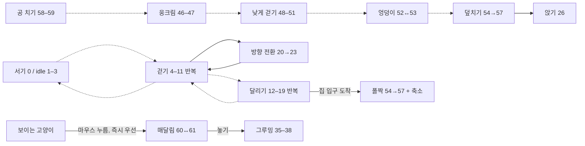

# 62장 animation 연결 지도

번호는 **0–61, 총 62장**이다. 번호가 이웃한다고 모두 이어 재생하지 않는다.
`SpriteAtlas.frameIndex`가 행동에 맞는 프레임을 선택하고, `SpriteAtlas.transition`과 `HabitatView.drawCat`이 행동 사이를 연결한다. `Habitat.swift`는 다음 행동과 이동 속도를 결정한다.

## 전체 번호표

| 번호 | 동작 | 실제 재생 |
|---|---|---|
| 0 | 서기 | 정지 자세 |
| 1–3 | 서서 꼬리 흔들기 | 1→2→3→2 반복, 초당 1.5장 |
| 4–11 | 걷기 | 4→5→…→11→4, **걸은 거리 12pt(성묘)마다 한 사이클**. 보통 속도(15pt/s)에서 10 fps와 같다. |
| 12–19 | 달리기 | 12→…→19→12, **달린 거리 29pt(성묘)마다 한 사이클**. 최고 속도(58pt/s)에서 16 fps와 같다. |
| 20–23 | 방향 전환 | 20→21→22→23 뒤 좌우 반전된 다음 자세, 장당 0.09초 |
| 24–26 | 서기→앉기 | 24→25→26; 반대로 일어나기 |
| 27–29 | 앉기→식빵 | 27→28→29; 반대로 앉기 |
| 30–32 | 식빵→잠 | 30→31→32; 반대로 깨기 |
| 33–34 | 잠/호흡 | 33↔34, 초당 0.65장 |
| 35–38 | 그루밍 | 35→36→37→38→35, 4 fps |
| 39–43 | 기지개 | 서기39→내려가기40→늘이기41→올라오기42→서기43, 3.2초에 한 번. 뒷다리 들기 없음 |
| 44–45 | 하품 | 앉은 뒤 4초부터 12초 간격, 44→45 후 26으로 복귀 |
| 46–47 | 웅크리기 | 멈춘 사냥과 공 치기 직전은 **46**(낮게 걷기와 높이가 비슷). 47(납작)은 지금 안 쓴다. |
| 48–51 | 낮게 걷기 | 48→…→51→48, **기어간 거리 4.8pt(성묘)마다 한 사이클** |
| 52–53 | 엉덩이 흔들기 | 사냥 중 wiggle 타이머가 켜지면 52↔53, 5 fps |
| 54–57 | 덮치기/집으로 폴짝 | 54→55→56→57, 0.45초/0.55초에 한 번, 끝 자세 유지 |
| 58–59 | 공 치기 | **공을 친 순간 한 번만**: 58(0.15초) → 59(0.15초). 그다음 지켜보는 동안 앉기 26, 다음에 치기 직전 46. |
| 60–61 | 매달려 발버둥 | 정지 1.5 fps, 드래그 속도 >5이면 4 fps. 별도 spring 회전으로 몸이 뒤따라 흔들림 |

## 쉬는 자세: 실제 연결 그림을 쓰는 경로

예: 서기에서 잠으로 가면 **24→25→26→27→28→29→30→31→32→33↔34**.
깨어서 움직이면 반대 연결을 재생한 뒤 목표 행동으로 간다. 연결 프레임은 장당 0.09초이며 방향 전환은 더 높은 우선순위를 갖는다.

## 이동·사냥·상호작용: 행동 경로와 현재 한계

**실선이 모두 전용 연결 그림이라는 뜻은 아니다.** 두 번째 지도는 행동 관계를 요약한다. 점선 구간에는 전용 연결 그림이 없고 0.15초 crossfade를 사용한다. 다른 정지 자세와 이동 자세 사이도 rest rank에 따라 위의 연결 그림을 선택하거나 crossfade한다. `held`와 `hopping`은 쉬기 전환을 생략한다. 방향이 바뀌면 고양이는 0.36초 제자리에 서서 20–23을 기존 방향으로 재생한 뒤 새 방향으로 걷는다. 재생하는 동안 몸 가운데를 돌기 전 위치에서 돈 뒤 위치로 조금씩 옮겨서, 마지막에 좌우 반전할 때 옆으로 튀지 않는다.

따라서 **연결 코드는 있지만, 62장만으로 모든 두 자세 사이의 그림이 준비된 것은 아니다.** 지도는 재생 관계를 명시하며, 그림의 자연스러움까지 보장하지 않는다. 특히 walk↔run 시작/끝, 하품↔앉기, 사냥↔일반 서기, held↔groom 연결은 후속 artwork 검수가 필요하다.

## 크기와 시간

- 다리 장면은 **이동한 거리**로 넘긴다. 느려지면 다리도 느려지고, 멈추면 서기로 바뀐다(발이 미끄러지지 않음).
- 보폭도 크기 배율을 곱하므로(속도와 같은 비율) Adult / Young / Kitten 모두 자기 보통 속도에서 같은 리듬(걷기 10, 달리기 16, 낮게 걷기 5 fps)이다.
- 바닥 맞추기: 앱이 그림마다 가장 아래 픽셀을 찾아 바닥선(232px)에 붙인다. 달리기(12–19)와 덮치기(54–57)는 묶음 전체를 같은 만큼 옮겨, 실제로 뜬 장면만 떠 보이게 한다. 매달림(60–61)은 그대로.
- 이동 속도와 가속도만 `size.scale` = 1 / 0.82 / 0.64를 곱한다. 보통 걷기는 15 / 12.3 / 9.6 pt/s.
- 정지하면 서기, 빠르게 움직이면 달리기로 **동작을 선택하는 기준**은 크기에 비례한다. 정지한 고양이에게 계속 걷기 애니메이션을 돌리지 않는다.
- Power mode의 화면 갱신 30/15/8 Hz는 모든 크기에 공통이다. 8 Hz에서는 일부 논리 프레임이 화면에 생략될 수 있지만 애니메이션 시간이 느려지지는 않는다.
- 같은 속도의 재생은 같은 위상이라는 뜻은 아니다. 시작 시점이 다른 고양이는 서로 다른 장면에 있을 수 있다.
